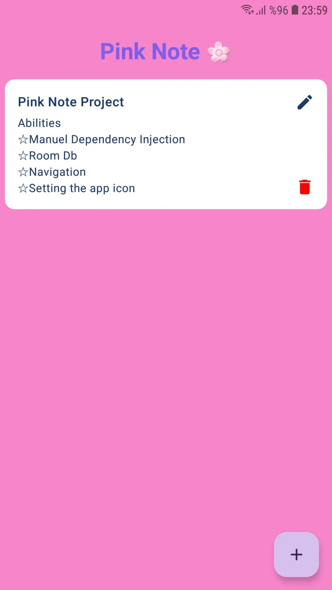
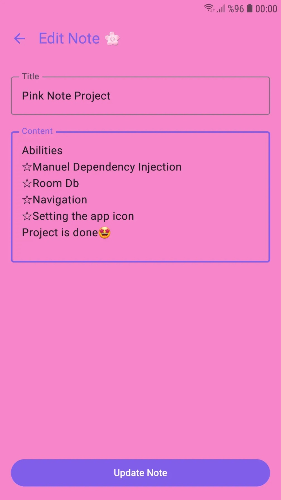
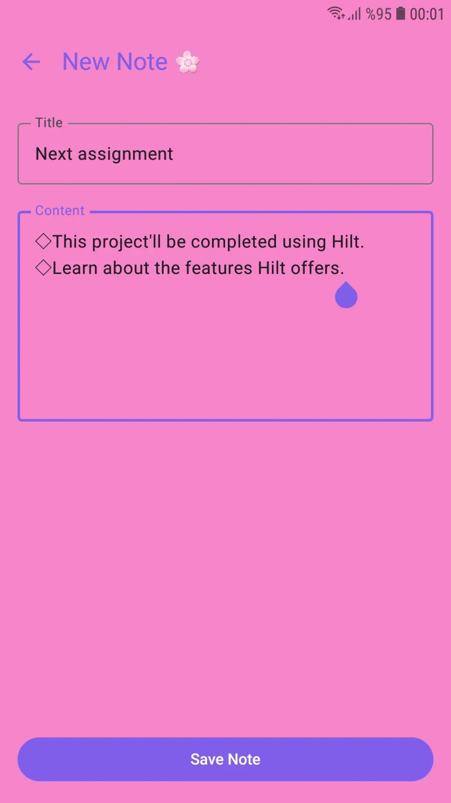
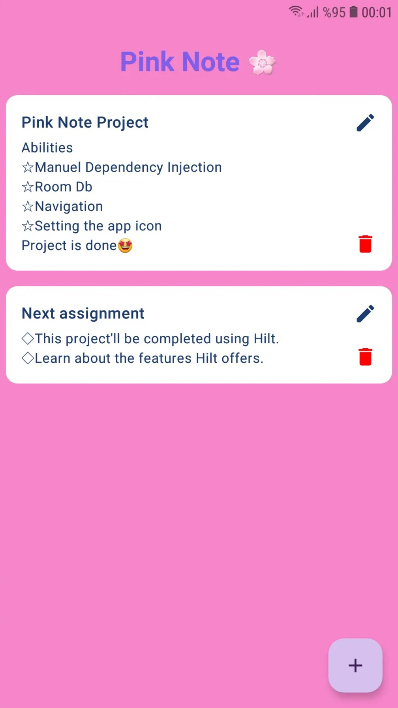

# 🌸 Pink Note App

Pink Note; Jetpack Compose kullanılarak geliştirilmiş modern bir Android not alma uygulamasıdır. Bu proje; Android dünyasında Bağımlılık Enjeksiyonu (Dependency Injection - DI) kavramının önce saf Kotlin ile manuel olarak nasıl kurulduğunu anlamak, ardından endüstri standardı olan Dagger Hilt kütüphanesine evrilerek sağladığı kolaylıkları deneyimlemek ve Jetpack Navigation bileşenlerini pratik etmek amacıyla iki aşamalı olarak tasarlanmıştır.

---

## 🌿 Proje Dalları (Branches ve Mimari Yapılar)

Proje, gelişim süreçlerini ve mimari yaklaşımları net bir şekilde görebilmeniz için iki ayrı branch üzerinde şekillenmiştir:

1. **`main` Branch (Saf Kotlin / Manuel DI):**
   * Herhangi bir harici DI kütüphanesi kullanılmadan tamamen saf Kotlin ile yazılmıştır.
   * Bağımlılıklar `ViewModelFactory` ve manuel constructor çağrılarıyla elle yönetilir.

2. **`hilt` Branch (Modern Hilt Mimarisi):**
   * Modern Android standartlarına uygun olarak **Dagger Hilt** entegrasyonu yapılmıştır.
   * `@Module`, `@Provides`, `@Singleton`, `@HiltAndroidApp`, `@AndroidEntryPoint`, `@HiltViewModel` ve `@Inject constructor` anotasyonları kullanılarak manuel kod kalabalığı ortadan kaldırılmıştır.

---

## 📌 Proje Amacı ve Öğrenilenler
* **Saf Kotlin ile Dependency Injection:** Framework (Dagger/Hilt/Koin) kullanmadan, `ViewModelFactory` ve Repository kalıbıyla bağımlılıkların manuel ve temiz bir şekilde sınıflara nasıl aktarılacağını öğrenmek.
* **Dagger Hilt Entegrasyonu:** Endüstri standardı DI kütüphanesinin projeye dahil edilmesi, modül yönetimi (`@Provides`, `@Singleton`) ve otomatik enjeksiyon süreçleri.
* **Room Database:** Yerel veritabanı işlemleri (`Entity`, `DAO`, `Database`) ve Coroutines ile asenkron veri akışını yönetmek.
* **Jetpack Compose Navigation:** `NavHost`, `navController` ve dinamik argüman (`noteId`) geçişleriyle ekranlar arası geçişleri kurmak.
* **Smart Screen Reuse (Akıllı Ekran Yeniden Kullanımı):** Aynı ekranı hem yeni kayıt ekleme hem de var olan kaydı güncelleme amacıyla akıllıca ortak kullanmak.

---

## ✨ Öne Çıkan Özellikler

1. **Not Listeleme Ekranı (`NoteScreen`):**
   * Kaydedilen tüm notlar modern kart bileşenleri (`NoteItem`) içinde listelenir.
   * Her kartın üzerinde **Düzenle (Kalem)** ve **Sil (Çöp Kutusu)** ikon butonları yer alır.
   * Sağ alt köşede yeni not eklemek için bir **Floating Action Button (+)** bulunur.

2. **Dinamik Ortak Ekran (`AddNoteScreen`):**
   * Hem yeni not eklemek hem de mevcut notu düzenlemek için **tek bir ekran** kullanılır.
   * Navigasyon sırasında gönderilen `noteId` parametresi kontrol edilir:
     * Eğer `noteId = -1` ise: Sayfa **"New Note"** moduyla açılır, boş alanlar sunulur ve kaydedildiğinde yeni kayıt eklenir (`insert`).
     * Eğer geçerli bir `noteId` geldiyse: Sayfa **"Edit Note"** moduyla açılır, `LaunchedEffect` arka planda ilgili notu bulur ve alanları otomatik doldurur; kaydedildiğinde mevcut kayıt güncellenir (`update`).

---

## 🏗️ Proje Mimarisi ve Paket Yapısı (`main` Branch)

```text
com.ipeksavas.pinknote
│
├── data
│   ├── dao
│   │   └── NoteDao.kt
│   ├── entity
│   │   └── NoteEntity.kt
│   ├── local
│   │   └── PinkNoteDatabase.kt
│   ├── navigation
│   │   └── PinkNoteNavGraph.kt
│   └── repository
│       └── NoteRepository.kt
│
├── presentation.notes
│   ├── AddNotesScreen.kt
│   ├── NoteScreen.kt
│   ├── NotesViewModelFactory.kt
│   └── NoteViewModel.kt
│
├── ui.theme
│   ├── Color.kt
│   ├── Theme.kt
│   └── Type.kt
│
└── MainActivity.kt
```

---

## 🏗️ Proje Mimarisi ve Paket Yapısı (`hilt` Branch)

```text
com.ipeksavas.pinknote
│
├── data
│   ├── dao
│   │   └── NoteDao.kt
│   ├── entity
│   │   └── NoteEntity.kt
│   ├── local
│   │   └── PinkNoteDatabase.kt
│   ├── navigation
│   │   └── PinkNoteNavGraph.kt
│   └── repository
│       └── NoteRepository.kt
│
├── di
│   └── AppModule.kt
│
├── presentation.notes
│   ├── AddNotesScreen.kt
│   ├── NoteScreen.kt
│   └── NoteViewModel.kt
│
├── ui.theme
│   ├── Color.kt
│   ├── Theme.kt
│   └── Type.kt
│
├── MainActivity.kt
└── PinkNoteApp.kt
```

---

## 🛠️ Kullanılan Teknolojiler
* **UI**: Jetpack Compose, Material Design 3
* **Mimari**: MVVM (Model-View-ViewModel)
* **Veritabanı**: Room Database
* **Navigasyon**: Jetpack Compose Navigation
* **Asenkron Programlama**: Kotlin Coroutines & Flow
* **Bağımlılık Enjeksiyonu**: Pure Kotlin (main) & Dagger Hilt (hilt)

---

## 📱 Pink Note Uygulamasının Ekran Görüntüleri

<p align="center">
  
  &nbsp; &nbsp;
  
  &nbsp; &nbsp;
  
  &nbsp; &nbsp;
  
</p>
